# Smart Desk Hub — native Android (Kotlin + Jetpack Compose)

A smart-office control app: switch the desk's devices, run scenes, automate the lamp and the
plug, watch four cameras, replay recordings, manage devices and users, and search every
action in a log. It started as a JavaFX + WebView desktop widget
([fmcoskun/javafx-smart-desk-widget](https://github.com/fmcoskun/javafx-smart-desk-widget))
and was rewritten from scratch as a native Android app, keeping the original's neumorphic
look pixel for pixel.

Everything runs on the phone with simulated devices, so it works without any network. The
code is written to be read: every file starts with what it is and which layer it belongs to,
and Android concepts are explained where they are first used.

| | | | | |
|---|---|---|---|---|
| 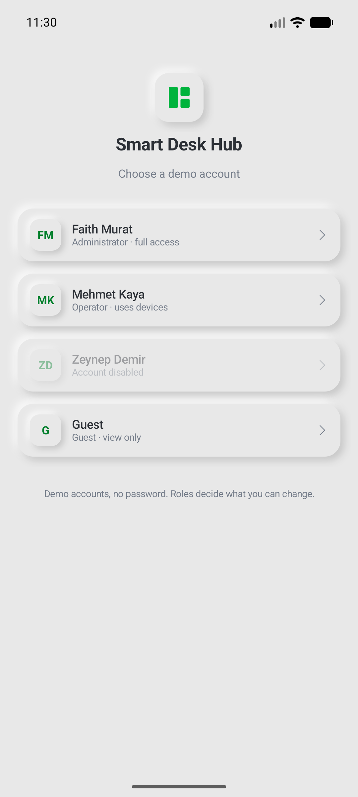 | 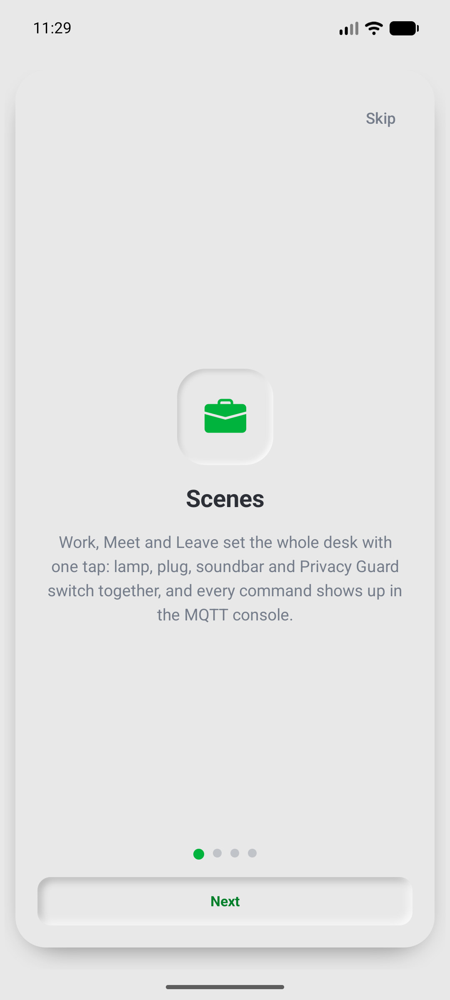 | 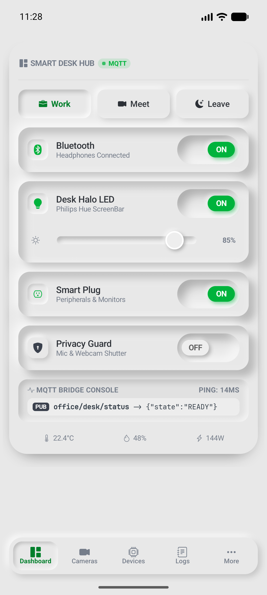 | 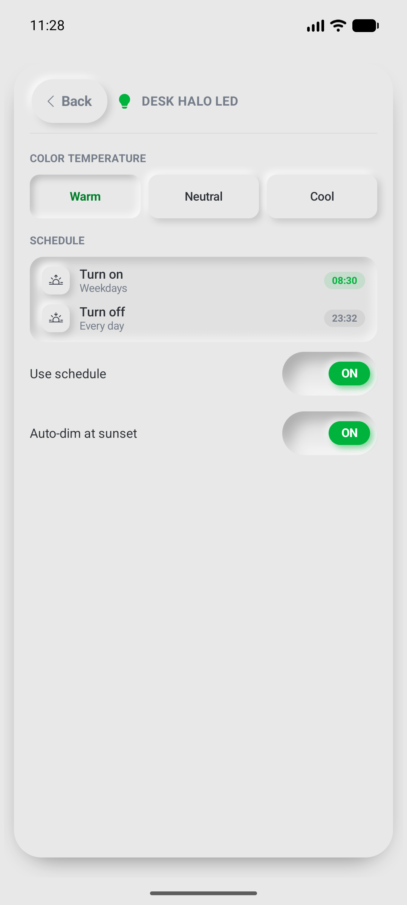 | 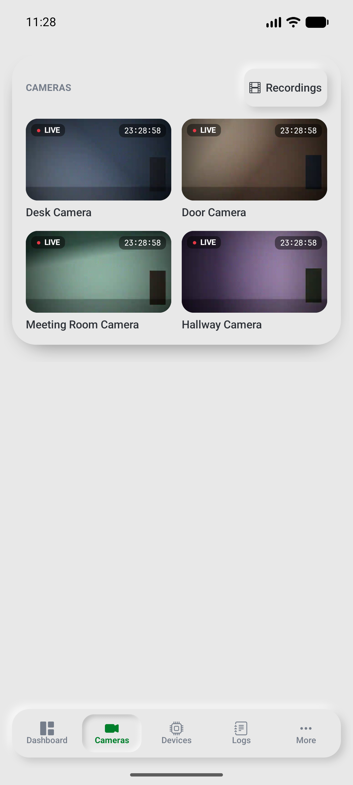 |
| 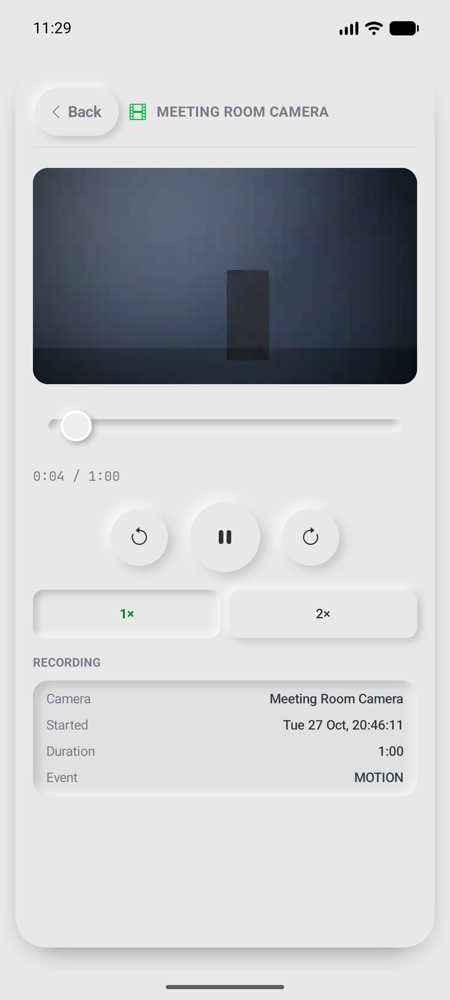 | 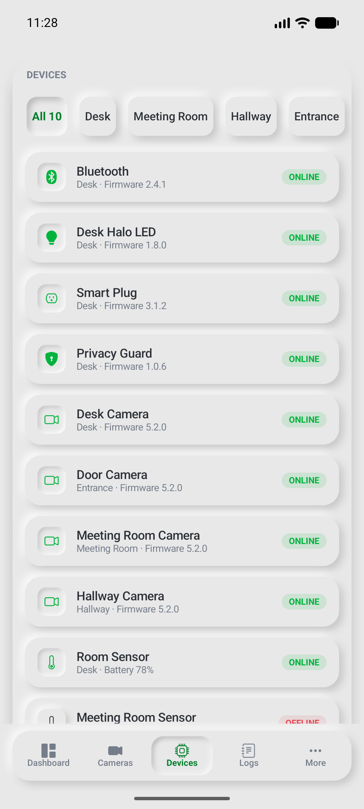 | 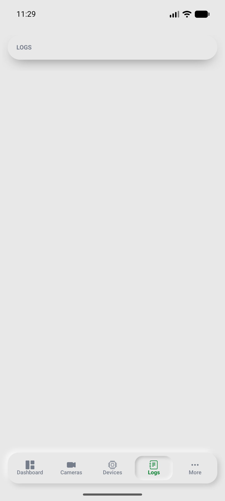 | 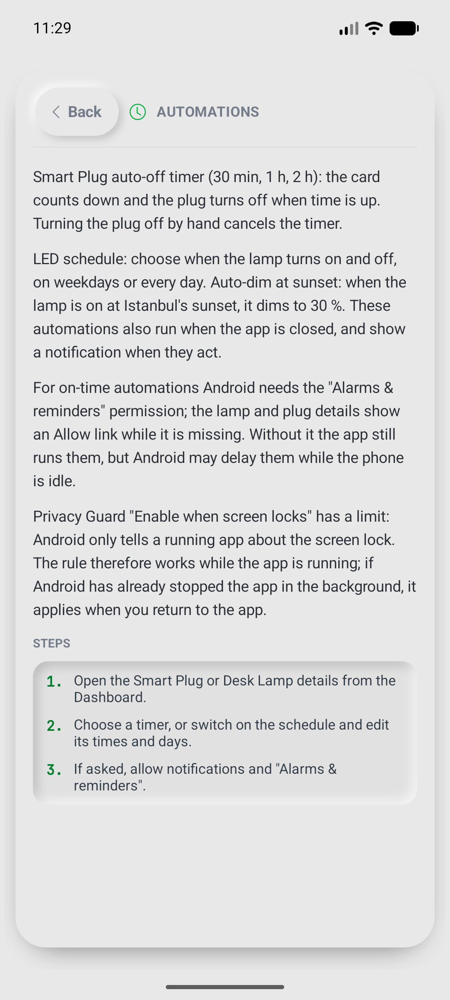 | 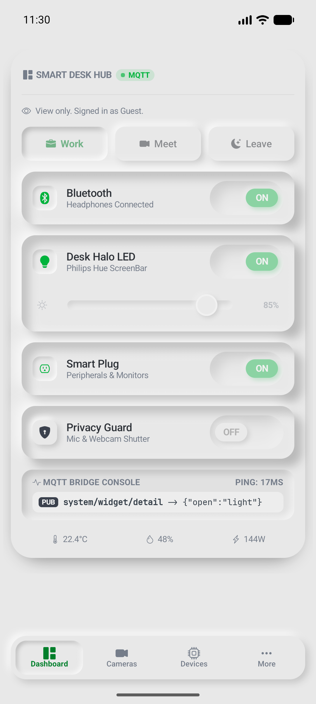 |

## Features

- **Dashboard** — Bluetooth soundbar, Desk Halo LED (with dimmer), Smart Plug and Privacy
  Guard; **Work / Meet / Leave** scenes; a live MQTT console; temperature, humidity and power.
- **Detail pages that really work** — audio output, colour temperature, a **plug auto-off
  timer**, an **LED schedule** and **sunset dimming** that run even when the app is closed
  (AlarmManager exact alarms, WorkManager fallback), notifications when they act.
- **Cameras** — four looping "live" feeds; the Desk camera goes dark while Privacy Guard is
  on; snapshots are logged.
- **Recordings** — per day and per camera, PERSON/MOTION tags, a Media3 player with seek,
  ±10 s and 1×/2×; rotation keeps your place.
- **Device manager** — status, firmware, IP/MAC, battery and signal; rename, change room,
  restart (the device goes offline for 5 s everywhere), add and delete.
- **Logs** — every client action and device event, live; text search, source/level/day/device
  filters; export as CSV through the share sheet.
- **Users and roles** — Admin, Operator and Guest, enforced in one place; user management
  with "last admin" and "no self-delete" rules.
- **Onboarding and User Guide** — a four-page welcome tour and ten searchable help topics.
- **Home-screen widget** (Jetpack Glance) — the scenes and the four switches on the launcher,
  live in both directions, with the same rules as the Dashboard (Guest and signed-out users
  see it read-only; offline devices are not switched).

  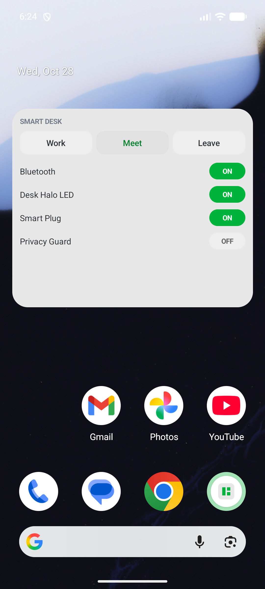

## Build and run

Requirements: **JDK 17** and the **Android SDK** (Android Studio installs both). The project
uses Gradle 9.8.2 (wrapper included), AGP 9.4.1 and Kotlin 2.4.21; `compileSdk`/`targetSdk`
37, `minSdk` 26.

```bash
./gradlew assembleDebug          # builds app/build/outputs/apk/debug/app-debug.apk
./gradlew test                   # runs the unit and Robolectric UI tests (323 tests)
```

**On the emulator:** open the project in Android Studio and press Run, or start an emulator
and install from the command line:

```bash
adb install -r app/build/outputs/apk/debug/app-debug.apk
adb shell am start -n com.iot.widget/.MainActivity
```

**On your phone:** Settings → About phone → tap *Build number* seven times to enable
Developer options; then Settings → System → Developer options → *USB debugging* on. Connect
the phone by USB, accept the prompt on the phone, check that `adb devices` lists it, and run
the same `adb install -r …` command.

Pick any demo account on the sign-in screen (there are no passwords). The Admin account sees
everything; Guest shows the view-only experience.

## Architecture

MVVM with a single source of truth: screens show `StateFlow`s from ViewModels, ViewModels
call repositories, and repositories own the data (Room and DataStore). Hilt wires it all
together.

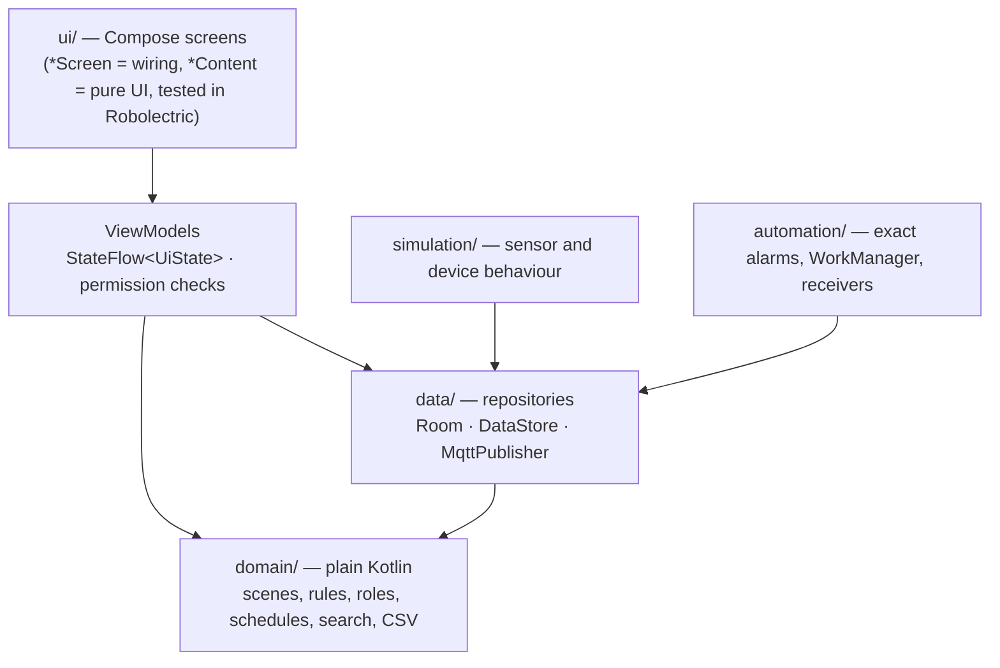

### Folder map (`app/src/main/kotlin/com/iot/widget/`)

| Folder | What lives there |
|---|---|
| `SmartDeskApp.kt`, `MainActivity.kt` | App start (Hilt, WorkManager setup, sample data), the single Activity |
| `di/` | Hilt module: which implementation each interface gets |
| `domain/` | Pure Kotlin, no Android: desk models, scenes, payloads, power, formatting, Turkish-aware names |
| `domain/users`, `domain/devices` | Roles → permissions table, user rules, device rules, pairing steps |
| `domain/automation` | Schedule maths and the sunset calculator |
| `domain/logs`, `domain/cameras`, `domain/guide` | Log query/retention/CSV, recordings and playback maths, guide topics and search |
| `data/` | Repository interfaces and their Room/DataStore implementations |
| `data/db` | Room entities, DAOs, the database (v5, auto-migrations, schemas in `app/schemas`) |
| `data/mqtt`, `data/log` | The MQTT seam (and a decorator that logs every publish), the event log |
| `simulation/` | Room sensor readings, device acks, restarts and occasional warnings |
| `control/` | `DeskCommands`: the switching rules shared by the Dashboard and the widget |
| `widget/` | The Glance home-screen widget, its tap actions and the Hilt entry point |
| `automation/` | Scheduling (exact alarms or WorkManager), workers, boot/permission receivers, screen lock, notifications |
| `ui/theme`, `ui/components`, `ui/icons` | Colours, fonts, neumorphic shadows, shared controls, Bootstrap Icons font |
| `ui/<feature>` | One folder per screen: dashboard, detail, login, onboarding, users, devices, cameras, recordings, logs, guide, more |
| `ui/navigation`, `ui/shell` | Type-safe routes and the nav graph; root (login / tour / app) and the bottom bar |

### One tap's journey

Tapping the Smart Plug switch on the Dashboard:

1. **UI** — `NeuSwitch` calls `DashboardViewModel.onToggle(SmartPlug, false)`; the screen holds
   no state of its own.
2. **ViewModel** — checks the user may control devices and that the plug is online, then calls
   `DeskRepository.setDeviceOn(...)` and cancels the plug's auto-off job.
3. **Repository → Room** — the new state is written to SQLite. Room's `Flow` emits the new row,
   so every screen that shows the plug's state (the Dashboard card and its detail page) updates
   by itself.
4. **MQTT** — the ViewModel publishes `office/desk/plug_main {"state":"OFF",…}` to
   `MqttPublisher`. The `RecordingMqttPublisher` decorator passes it on and writes a CLIENT log
   entry; 200 ms later the same decorator writes the device's "ack" as a DEVICE entry (a stand-in
   for the confirmation a real device would send).
5. **Back to the UI** — the console shows the last message, the Logs tab shows both entries
   live, and the footer's power figure drops.

### Roles

| Capability | Admin | Operator | Guest |
|---|:-:|:-:|:-:|
| See the Dashboard and live cameras | ✓ | ✓ | ✓ |
| See the device list and device details | ✓ | ✓ | ✓ |
| Use switches, scenes and sliders | ✓ | ✓ | – |
| Recordings | ✓ | ✓ | – |
| Rename / move / restart devices | ✓ | ✓ | – |
| Add / delete devices | ✓ | – | – |
| Logs | ✓ | ✓ | – (no tab) |
| Manage users | ✓ | – | – |

The table is `Role.permissions` in `domain/users/User.kt`; screens hide what you cannot use,
and ViewModels check again before acting.

### Where a real MQTT broker plugs in

All traffic goes through the `MqttPublisher` interface (`data/mqtt/MqttPublisher.kt`). Today
`LoggingMqttPublisher` only logs the message and remembers the last one for the console (it is
marked `TODO(MQTT)`). A real client (for example HiveMQ) would implement the same interface and
be bound in `di/AppModule.kt`. Device events received from the broker would replace
`simulation/` and the made-up "ack" that `RecordingMqttPublisher` writes 200 ms after each
switch command. Screens and ViewModels stay as they are.

### A known Android limit

"Enable when screen locks" (Privacy Guard) works while the app is running. While the app sits
in the background (cached), Android holds the screen-lock broadcast back and delivers it when
you return, so the rule applies then. If Android has closed the app in the meantime, that lock
is missed: catching it at all times would need a permanent foreground-service notification,
which this demo deliberately avoids. The in-app User Guide says the same.

## From WebView to Compose

The original widget was HTML/CSS/JS inside a JavaFX WebView. The first Android version simply
hosted the same page in a WebView. This rewrite replaces it with native Compose:

- The CSS variables became `ui/theme` tokens (same colours, Roboto and JetBrains Mono embedded),
  and the CSS box-shadows became `Modifier.dropShadow` / `innerShadow` neumorphic modifiers.
- Bootstrap Icons are used through their font, so the glyphs are exactly the original ones.
- `app.js`'s state and scene logic moved into a pure Kotlin `applyScene` function with tests.
- The old web UI is kept in `reference/web-ui/` (not part of the build) as the design source.

## Tests

`./gradlew test` runs 323 tests (the debug unit-test task, `testDebugUnitTest`): domain rules (roles, scenes, power, schedules, sunset, CSV,
search), Room repositories and database migrations, ViewModels with fake repositories and
virtual time, and Compose screens in Robolectric (including whole-app navigation with Hilt).

## Libraries and licences

| Library / asset | Licence |
|---|---|
| Jetpack Compose (BOM 2026.09.00), Material 3, Navigation, Lifecycle | Apache 2.0 |
| Hilt 2.60.1, Room 2.8.5, DataStore 1.3.0, WorkManager 2.12.0 | Apache 2.0 |
| Media3 ExoPlayer 1.11.1, Glance 1.2.0, kotlinx.serialization, kotlinx.coroutines | Apache 2.0 |
| Roboto, JetBrains Mono (`res/font`) | SIL OFL 1.1 — `licenses/` |
| Bootstrap Icons (font) | MIT — `licenses/` |
| Demo camera clips (`res/raw`) | Generated by `tools/make_clips.sh` with FFmpeg's synthetic sources; no third-party footage — `licenses/VIDEO-CLIPS.txt` |
| Original widget | `LICENSE-original-widget` |

## Glossary

- **Composable** — a function that describes part of the UI; Compose calls it again
  (*recomposition*) whenever the state it reads changes.
- **State hoisting** — keeping state in the caller (usually the ViewModel) and passing values
  and callbacks down, so a composable is easy to preview and test.
- **ViewModel** — survives rotation; holds screen state and starts work in `viewModelScope`,
  which is cancelled when the screen is gone for good.
- **Flow / StateFlow** — a stream of values over time; a `StateFlow` always has a current value
  that the UI collects with `collectAsStateWithLifecycle`.
- **Hilt** — dependency injection: classes ask for what they need in their constructor and Hilt
  supplies it (tests supply fakes instead).
- **Room / DAO** — SQLite with compile-time-checked SQL; a DAO is the interface with the queries.
- **DataStore** — a small key-value file (who is signed in, whether the tour was seen).
- **WorkManager / exact alarms** — background work that survives the app being closed; exact
  alarms fire on time when the user allows them.
- **`remember` / `rememberSaveable`** — keep a value across recompositions; the saveable one also
  survives rotation.
- **`LaunchedEffect` / `DisposableEffect`** — run a coroutine, or set up and clean up a resource
  (like a video player), tied to a composable's lifetime.
